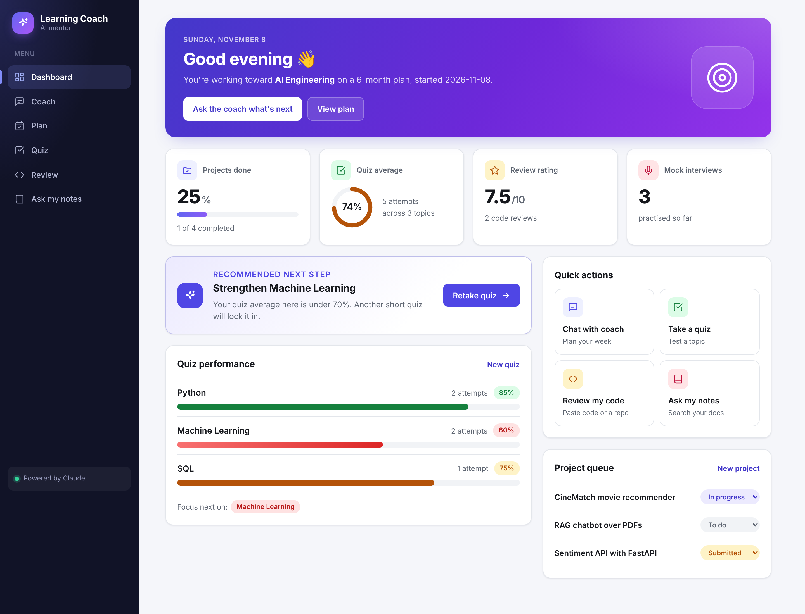
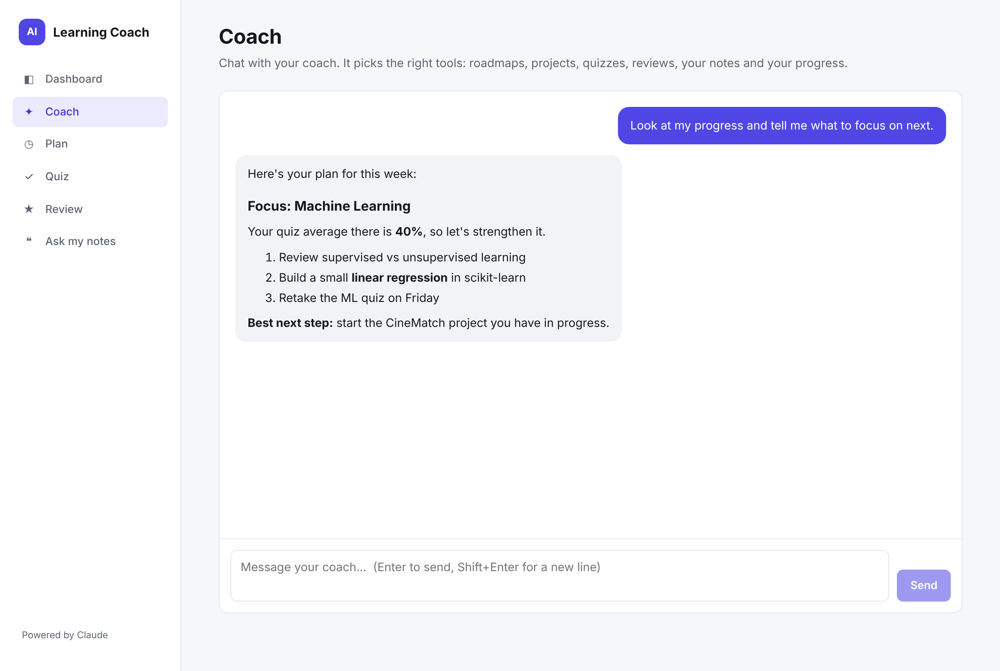
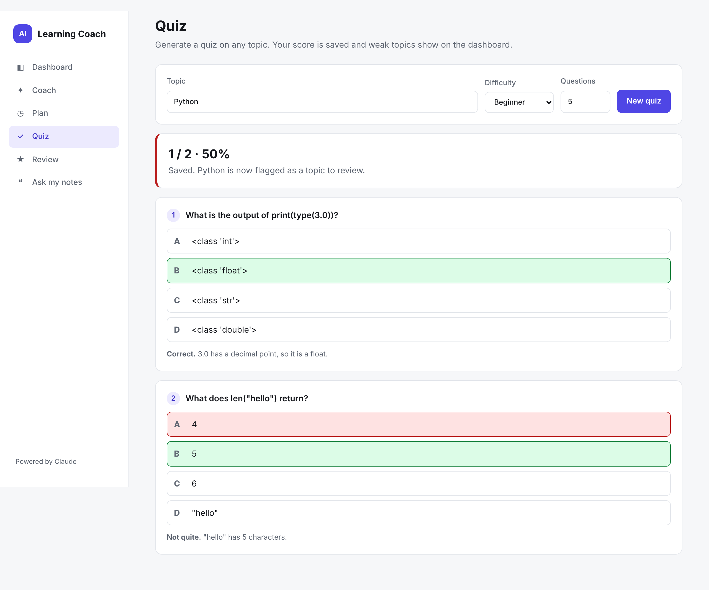
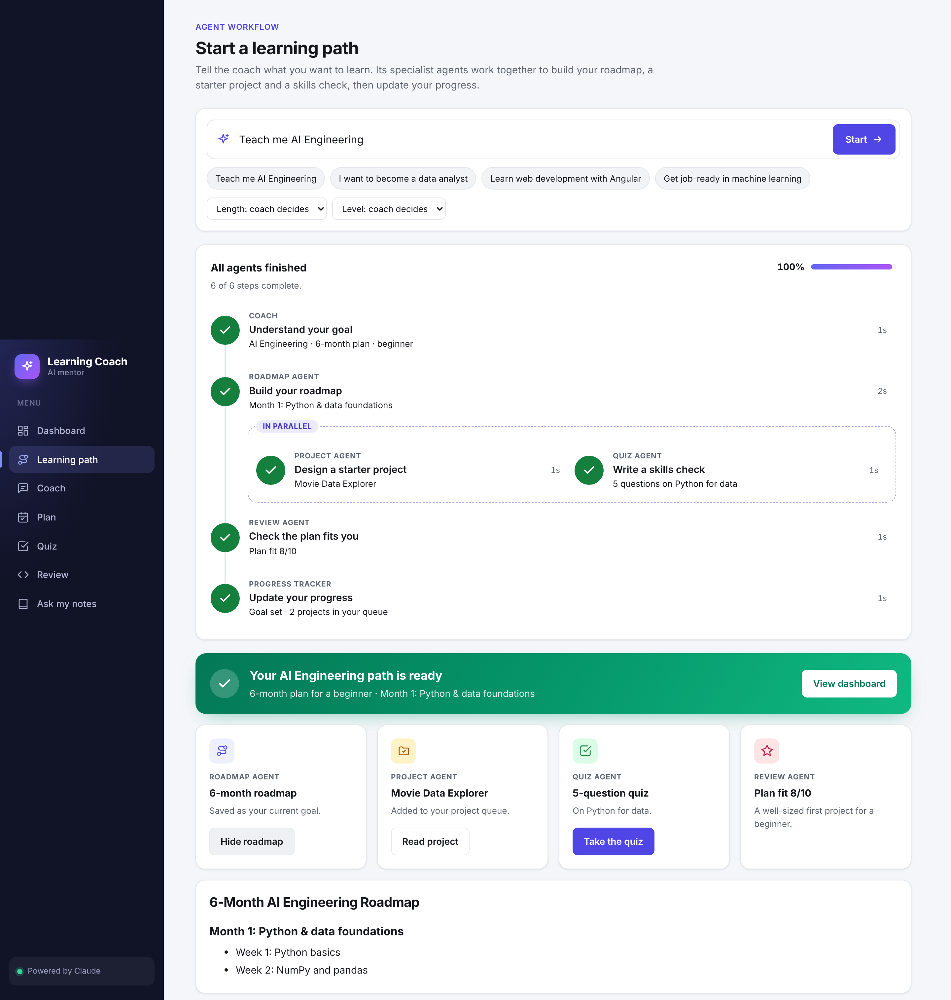

# AI Learning Coach

An agentic AI learning coach powered by **Claude**. Tell it a goal ("I want to become an
AI Engineer in 12 months") and it plans, teaches, assesses, reviews and adapts:

1. Creates a roadmap
2. Creates weekly projects
3. Generates quizzes
4. Generates interview questions
5. Reviews submitted work and gives feedback
6. Tracks progress and recommends next steps



| Coach chat | Quiz |
|---|---|
|  |  |



## Architecture

```
Angular frontend (Phase 12)
        │
Node.js + TypeScript API (Express)
        │
Coach Orchestrator  ── a Claude agent that calls the specialists as tools
   ┌────┼──────────┬───────────┬────────────┐
Roadmap Project   Quiz     Interview    Review      ← specialist agents (Claude)
        │
RAG: vector search over knowledge/ (Phase 9)   MCP tools: calendar, GitHub, progress (Phase 10)
        │
PostgreSQL via Prisma: users, projects, quizzes, submissions, progress (Phase 11)
```

- **LLM:** Claude (`claude-opus-5-5` by default, set `CLAUDE_MODEL` to change) via `@anthropic-ai/sdk`.
- **Structured outputs:** quizzes, reviews and interviews come back as JSON validated by Zod.
- **Agent workflow (Phase 13):** "Teach me AI Engineering" runs the specialist agents as one
  pipeline (see [Agent workflow](#agent-workflow-phase-13)). `/api/coach/chat` uses the SDK tool
  runner, so Claude can also decide which agents to call, including starting that pipeline.

## Getting started

```bash
npm install
cp .env.example .env      # then paste your key from https://platform.claude.com
npm run db:setup          # creates the progress database (data/coach.db)
npm run ingest            # builds the knowledge index for RAG
npm run dev               # http://localhost:5000
```

Then start the web app in a second terminal:

```bash
cd frontend
npm install
npm start                 # http://localhost:4200
```

## API

| Method | Path | Body |
|---|---|---|
| GET | `/health` | |
| POST | `/api/coach/roadmap` | `{ "skill": "AI Engineering", "durationMonths": 12, "currentLevel": "beginner" }` |
| POST | `/api/coach/project` | `{ "learnedSoFar": "Python basics" }` |
| POST | `/api/coach/quiz` | `{ "topic": "Machine Learning", "difficulty": "beginner", "count": 10 }` |
| POST | `/api/coach/interview` | `{ "role": "AI Engineer", "level": "junior" }` |
| POST | `/api/coach/review` | `{ "submission": "<code or text>", "context": "optional assignment" }` |
| POST | `/api/coach/schedule` | `{ "goal": "Learn Python", "weeks": 4, "days": ["Mon","Wed","Fri"], "startTime": "19:00" }` returns dated sessions plus an `.ics` file in `data/calendar/` |
| POST | `/api/coach/review-repo` | `{ "url": "https://github.com/owner/repo" }` reviews a public GitHub repo |
| POST | `/api/coach/ask` | `{ "question": "What is the difference between RAG and fine-tuning?" }` returns an answer with citations from `knowledge/` |
| GET | `/api/progress` | Dashboard data: current goal, project queue, quiz scores by topic, weak topics, review ratings |
| POST | `/api/progress/quiz/:quizId/submit` | `{ "answers": [1, 0, 2] }` grades a saved quiz (0-based option indexes) and records the score |
| PATCH | `/api/progress/projects/:projectId` | `{ "status": "in_progress" }` (todo, in_progress, submitted, done) |
| POST | `/api/coach/workflow` | `{ "goal": "Teach me AI Engineering", "durationMonths": 6, "level": "beginner" }` (months and level optional). Runs the full agent workflow and streams one JSON event per line. |
| GET | `/api/progress/quiz/:quizId` | A saved quiz (used to open the learning path's quiz) |
| POST | `/api/coach/chat` | `{ "messages": [{ "role": "user", "content": "Teach me AI Engineering" }] }` returns `{ "reply": "..." }`. To continue, send the history back with `{ "role": "assistant", "content": reply }` appended. |

Try it:

```bash
curl -X POST localhost:5000/api/coach/quiz -H "content-type: application/json" \
  -d '{"topic":"Machine Learning","count":3}'
```

## RAG (Phase 9)

```
knowledge/*.pdf|.md|.txt ─► load ─► chunk ─► embed (Voyage AI) ─► data/index.json
question ─► embed ─► top-5 similar chunks ─► Claude answers with [1] [2] citations
```

1. Put your PDFs and notes in `knowledge/` (starter notes are included).
2. Run `npm run ingest` to build the index. Re-run it whenever you add files.
3. Ask: `POST /api/coach/ask`, or just chat. The Coach agent has a `search_knowledge_base` tool.

Claude doesn't produce embeddings, so semantic search uses **Voyage AI** (set `VOYAGE_API_KEY`
in `.env`, then re-run ingest). Without a key it falls back to keyword search (BM25), so it works
with zero setup. The store is a JSON file, which is fine for a personal library; swap it for
ChromaDB or pgvector at deploy time by reimplementing `src/vector/store.ts`.

## MCP server (Phase 10)

The coach is also an **MCP server**, so any MCP client (Claude Desktop, Claude Code, IDEs) can use
its tools: `create_roadmap`, `create_project`, `create_quiz`, `create_mock_interview`,
`review_submission`, `review_github_repo`, `schedule_study_plan`, `search_knowledge_base`,
`ask_knowledge_base`.

**Claude Desktop (Windows):** Settings → Developer → Edit Config, then add (adjust the path):

```json
{
  "mcpServers": {
    "ai-learning-coach": {
      "command": "node",
      "args": [
        "C:\\Users\\YOU\\AI-Learning-Coach\\node_modules\\tsx\\dist\\cli.mjs",
        "C:\\Users\\YOU\\AI-Learning-Coach\\src\\mcp\\server.ts"
      ]
    }
  }
}
```

Restart Claude Desktop and ask "Use the learning coach to schedule a 4-week Python study plan".
The server reads `.env` from the project folder, so no keys go in the config.

**Claude Code:** `claude mcp add ai-learning-coach -- npm --prefix /path/to/AI-Learning-Coach run -s mcp`

The tools live in `src/tools/` and are shared by the MCP server, the REST API and the Coach agent.

## Progress tracking (Phase 11)

Every roadmap, project, quiz, interview and review is saved through Prisma, whether it came
from the REST API, the Coach agent or the MCP server. Quizzes come back with a `quizId`; submit
answers to `/api/progress/quiz/:quizId/submit` and the server grades them. `GET /api/progress`
powers the dashboard, and the Coach agent's `get_progress` tool lets it target weak topics.

- Database: SQLite file `data/coach.db` locally, so there's nothing to install. For Azure PostgreSQL,
  set `provider = "postgresql"` in `prisma/schema.prisma` and point `DATABASE_URL` at it.
- `npm run db:studio` opens Prisma Studio to browse your data.
- After pulling schema changes, run `npm run db:setup` again.

## Agent workflow (Phase 13)

When the learner says something like "Teach me AI Engineering", specialist agents collaborate
and hand their results to each other (`src/workflows/learning.workflow.ts`):

```
Intake ─▶ Roadmap Agent ─▶ ┬─ Project Agent ─┬─▶ Review Agent ─▶ Progress update
                           └─ Quiz Agent ────┘
```

1. **Intake** turns the request into a goal, plan length and level (structured output).
2. **Roadmap Agent** writes the plan (saved as the current goal); a planner picks month 1's focus.
3. **Project Agent** and **Quiz Agent** both build on month 1, so they run in parallel.
4. **Review Agent** checks the starter project fits the learner's level and adds tips.
5. **Progress update** reloads the dashboard data.

Run it from the **Learning path** page (live step-by-step view), `POST /api/coach/workflow`, the
Coach chat (its `start_learning_path` tool), or MCP (`start_learning_path`).

```bash
curl -N -X POST localhost:5000/api/coach/workflow -H "content-type: application/json" \
  -d '{"goal":"Teach me AI Engineering"}'
```

## Build plan

- [x] Phase 1–2: TypeScript backend and folder structure
- [x] Phase 3: Claude integration
- [x] Phases 4–8: Roadmap, Project, Quiz, Interview and Review agents
- [x] Phase 9: RAG over `knowledge/` (file vector store, Voyage AI embeddings or keyword fallback)
- [x] Phase 10: MCP server + calendar and GitHub tools (progress tool comes with Phase 11)
- [x] Phase 11: Prisma progress tracking (SQLite locally, PostgreSQL at deploy)
- [x] Phase 12: Angular frontend (dashboard, coach chat, quiz, review, ask my notes, plan)
- [x] Phase 13: agent workflow (Roadmap → Project + Quiz in parallel → Review → Progress) with a live Learning path page
- [ ] Phase 14: Deploy to Azure (App Service, PostgreSQL, Static Web Apps)

## Project structure

```
frontend/          Angular app (see frontend/README.md)
src/
├── agents/        roadmap, project, quiz, interview, review, knowledge, orchestrator
├── config/        env + Claude client helpers
├── controllers/   request validation + responses
├── routes/        /api/coach/*
├── services/      CoachService (agent + save) and ProgressService (database + analytics)
├── db/            Prisma client
├── generated/     Prisma client code (generated, git-ignored)
├── mcp/           MCP server (stdio) exposing the coach's tools
├── tools/         calendar (.ics) and GitHub review tools
├── workflows/     Phase 13 learning workflow (multi-agent pipeline)
├── types/         Zod schemas for structured outputs
├── scripts/       ingest.ts (builds the RAG index)
├── vector/        loader, chunker, embeddings, store
├── app.ts
└── server.ts
prisma/            schema.prisma and migrations
knowledge/         PDFs and notes for RAG; run `npm run ingest` after changes
data/              generated index (git-ignored)
```
